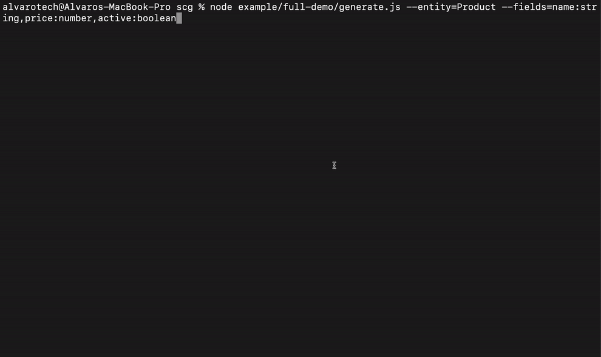

# SCG - Simple Code Generator

[](https://www.npmjs.com/package/@tiveor/scg)
[](https://github.com/tiveor/scg/actions/workflows/ci.yml)
[](https://opensource.org/licenses/MIT)
[](https://nodejs.org/)
[](https://www.typescriptlang.org/)

A utility library for code generation and template processing in Node.js. Provides helpers for template rendering (EJS, Handlebars, Pug), string manipulation, file operations, command execution, CLI parameter parsing, a scaffold engine, a template pipeline, and a file watcher.

Written in TypeScript with full type definitions. Supports both ESM and CommonJS.



## Installation

```bash
npm install @tiveor/scg
```

## Quick Start

Generate a React component in one command, no install needed:

```bash
npx @tiveor/scg new react-component Button
```

```
✔ created    src/components/Button/Button.tsx
✔ created    src/components/Button/Button.module.css
✔ created    src/components/Button/Button.test.tsx
✔ created    src/components/Button/index.ts
```

In a terminal, SCG asks for anything you didn't pass. In CI or from an AI agent it never waits: pass values as flags (`--withTest=false`) or `--yes` to accept the defaults, and it tells you exactly which flags are missing.

```bash
npx @tiveor/scg list                 # see every generator
npx @tiveor/scg init widget          # create your own in .scg/widget/
npx @tiveor/scg new widget PriceTag  # and run it
```

As a library:

```typescript
// ESM
import { Scaffold, TemplateBuilder, Casing } from '@tiveor/scg';

// CommonJS
const { Scaffold, TemplateBuilder, Casing } = require('@tiveor/scg');
```

## API Reference

Full API documentation is available via TypeDoc:

```bash
pnpm docs            # Generates HTML docs in ./docs
```

### TemplateBuilder

Unified interface to render templates with EJS, Handlebars, Pug, or any custom engine.

```typescript
const builder = new TemplateBuilder(TEMPLATE_HANDLERS.EJS);

// Render from string
const html = await builder.render('Hello <%= name %>', { name: 'World' });

// Render from file
const page = await builder.renderFile('template.ejs', { title: 'Home' });
```

Available handlers: `TEMPLATE_HANDLERS.EJS`, `TEMPLATE_HANDLERS.HANDLEBARS`, `TEMPLATE_HANDLERS.PUG`

#### Plugin System

Register custom template engines without modifying the library:

```typescript
import nunjucks from 'nunjucks';

TemplateBuilder.registerEngine('nunjucks', {
  render: async (source, data) => nunjucks.renderString(source, data),
  renderFile: async (file, data) => nunjucks.render(file, data),
});

const builder = new TemplateBuilder('nunjucks');
const result = await builder.render('Hello {{ name }}', { name: 'World' });

// List all available engines
TemplateBuilder.getRegisteredEngines();
// => ['HANDLEBARS', 'EJS', 'PUG', 'nunjucks']
```

### Pipeline

Chain transformations on template output:

```typescript
import { Pipeline } from '@tiveor/scg';

const result = await new Pipeline()
  .fromTemplate('component.ejs', { name: 'Button' }, 'EJS')
  .transform((content) => content.toUpperCase())
  .transform(addLicenseHeader)
  .writeTo('src/components/Button.tsx');

// Other input methods
new Pipeline().fromString('raw content');
new Pipeline().fromFile('input.txt');
new Pipeline().fromTemplateString('<%= name %>', { name: 'World' }, 'EJS');
```

### Scaffold

Generate directory structures from manifests:

```typescript
import { Scaffold } from '@tiveor/scg';

const result = await Scaffold.from({
  engine: 'EJS',
  templateDir: './templates/react-component',
  outputDir: './src/components/{{name:pascal}}',
  variables: { name: 'user profile', cssModule: true, withTest: true },
  structure: [
    { template: 'component.ejs', output: '{{name:pascal}}.tsx' },
    { template: 'styles.ejs',    output: '{{name:pascal}}.module.css', when: 'cssModule' },
    { template: 'test.ejs',      output: '{{name:pascal}}.test.tsx', when: 'withTest' },
    { template: 'index.ejs',     output: 'index.ts' },
  ]
});

console.log(result.files);     // Files written
console.log(result.skipped);   // Existing files with local changes, left untouched
console.log(result.unchanged); // Existing files already identical to the output

// Preview without writing files
const preview = await Scaffold.from({ ...options, dryRun: true });

// Replace existing files that differ from the templates
await Scaffold.from({ ...options, overwrite: true });
```

### Watcher

Watch templates and regenerate on changes:

```typescript
import { Watcher } from '@tiveor/scg';

const watcher = new Watcher({
  templateDir: './templates',
  outputDir: './generated',
  engine: 'EJS',
  variables: { project: 'MyApp' },
  onRebuild: (file) => console.log(`Rebuilt: ${file}`),
  onError: (err, file) => console.error(`Error in ${file}: ${err.message}`),
});

watcher.start();
// watcher.stop();
```

### StringHelper

Static methods for string manipulation.

```typescript
// Replace all occurrences of a token (regex-safe)
StringHelper.replace('Hello {{name}}!', '{{name}}', 'World');
// => "Hello World!"

// Works safely with regex special characters
StringHelper.replace('Price: $10.00', '$10.00', '$20.00');
// => "Price: $20.00"

// Capitalize first character
StringHelper.capitalize('hello');
// => "Hello"

// Escape regex special characters
StringHelper.escapeRegex('$100.00 (test)');
// => "\\$100\\.00 \\(test\\)"
```

### FileHelper

Static methods for file system operations (sync and async).

```typescript
// Sync
const content = FileHelper.readFileToString('config.txt');
const config = FileHelper.convertJsonFileToObject('config.json');
FileHelper.createFolder('output/components');
FileHelper.removeFolder('output/temp');
FileHelper.removeFile('output/old.txt');

// Async
const data = await FileHelper.readFileAsync('config.txt');
const json = await FileHelper.readJsonFileAsync('config.json');
await FileHelper.writeFileAsync('output/file.txt', 'content');
await FileHelper.createFolderAsync('output/components');
await FileHelper.removeFolderAsync('output/temp');
await FileHelper.removeFileAsync('output/old.txt');
const exists = await FileHelper.existsAsync('some/path');

// Generate file from template with variable replacement
await FileHelper.createFileFromFile({
  template: 'templates/component.txt',
  newFile: 'output/Button.tsx',
  variables: [
    { token: '{{name}}', value: 'Button' },
    { token: '{{style}}', value: 'primary' }
  ]
});
```

### CommandHelper

Execute shell commands as promises (with input sanitization).

```typescript
// Run a command
const output = await CommandHelper.run('.', 'echo hello');

// Chain multiple commands
const result = await CommandHelper.run('.', 'git add .', 'git status');

// Run and clean output (strips newlines)
const version = await CommandHelper.runClean('.', 'node --version');
```

### ParamHelper

Parse CLI parameters from `process.argv`.

```typescript
// Add custom parameters
ParamHelper.addCustomParam('--env=production');

// Get parameter by index
const script = ParamHelper.getCommandByIndex(1);

// Parse all --key=value parameters
// Example: node script.js --name=Alice --port=3000
const params = ParamHelper.getParams();
// => { name: "Alice", port: "3000" }
```

## CLI

```bash
# Run a generator by name (asks for missing values in a terminal)
npx @tiveor/scg new react-component Button

# Pass values as flags; --yes uses defaults for the rest and never asks
npx @tiveor/scg new react-component Button --cssModule=false --withTest=false --yes

# List generators: your project's (.scg/) first, then the built-in ones
npx @tiveor/scg list

# Create a project generator in .scg/<name>/ (manifest + example template)
npx @tiveor/scg init widget

# Preview without writing files
npx @tiveor/scg new react-component Button --dry-run

# Existing files with local changes are never overwritten unless you pass --force
npx @tiveor/scg new react-component Button --force

# Run a manifest by path; values via --vars (pairs or JSON)
npx @tiveor/scg generate --manifest=scaffold.json --vars='{"name":"Button","withTest":true}'

# Render a single template
npx @tiveor/scg render template.ejs --data='{"name":"World"}' --output=output.html
```

Exit codes: `0` success, `1` error (missing input, invalid value, unknown generator), `130` cancelled with Ctrl+C (nothing is written).

## Your Own Generators

`scg new <name>` looks for `.scg/<name>/scaffold.json` in the current folder first, then for a built-in pack. A project generator with the same name as a built-in one replaces it, so you can customize `react-component` for your team.

```json
{
  "name": "react-component",
  "description": "React component with test",
  "engine": "EJS",
  "templateDir": ".",
  "outputDir": "src/components/{{name:pascal}}",
  "prompts": [
    { "name": "name", "type": "text", "message": "Component name",
      "positional": true, "required": true, "pattern": "^[A-Za-z][A-Za-z0-9 _-]*$" },
    { "name": "withTest", "type": "confirm", "message": "Add a test?", "default": true }
  ],
  "structure": [
    { "template": "component.ejs", "output": "{{name:pascal}}.tsx" },
    { "template": "test.ejs", "output": "{{name:pascal}}.test.tsx", "when": "withTest" }
  ]
}
```

| Field | Meaning |
|---|---|
| `engine` | `EJS`, `HANDLEBARS`, `PUG` or a registered custom engine |
| `templateDir` | Folder with the templates, relative to the manifest |
| `outputDir` | Where files go, relative to where you run the command |
| `prompts[]` | Inputs: `name`, `type` (`text`, `confirm`, `select`, `multiselect`, `number`), `message`, `default`, `choices`, `required`, `positional` (one per manifest), `pattern` (text only), `description` |
| `structure[]` | Files: `template`, `output`, and optional `when` (`"withTest"` or `"!withTest"`) |
| `variables` | Optional fixed values / defaults (older manifests use only this) |

Values are taken from, in order: flags (`--name=Button`, or `--vars`), the positional argument, an interactive answer, the `default`. Flag values are converted to the prompt's type (`--withTest=no` → `false`, `--features=a,b` → `["a","b"]`) and checked against `choices` and `pattern`. The manifest is validated when it is loaded, and every problem is reported at once.

### Casing helpers

| Modifier | `user profile` → |
|---|---|
| `pascal` | `UserProfile` |
| `camel` | `userProfile` |
| `kebab` | `user-profile` |
| `snake` | `user_profile` |
| `constant` | `USER_PROFILE` |
| `title` | `User Profile` |
| `lower` / `upper` | `user profile` / `USER PROFILE` |
| `plural` | `user profiles` (simple English rules: `category` → `categories`) |

- In paths: `{{name:pascal}}` (`{{name}}` keeps the raw value).
- In EJS and Pug templates: `<%= h.pascal(name) %>`, `h.kebab(name)`, ...
- In Handlebars templates: `{{pascal name}}`. A variable with the same name as a helper (e.g. `title`) wins.
- In code: `Casing.pascal('user profile')`.

## Built-in Generators

| Generator | Creates | Inputs |
|---|---|---|
| **react-component** | `Name.tsx`, `index.ts`, optional `Name.module.css` and `Name.test.tsx` | `name`, `cssModule`, `withTest` |
| **vue-component** | `Name.vue`, optional `Name.test.ts` | `name`, `withTest` |
| **express-route** | `name.routes.ts`, `name.controller.ts`, `name.service.ts` | `name` |
| **github-action** | `.github/workflows/name.yml` | `name`, `branch`, `nodeVersions`, `packageManager` |

Programmatically:

```typescript
import { resolveGenerator, loadManifest, resolveInputs, Scaffold } from '@tiveor/scg';

const generator = resolveGenerator('react-component');
const manifest = loadManifest(generator.manifestPath);
const variables = await resolveInputs(manifest, { name: 'Button', withTest: false }, {
  generatorName: generator.name,
  interactive: false
});
const result = await Scaffold.from({ ...manifest, variables });
console.log(result.files);
```

## Examples & Demos

See **[EXAMPLES.md](EXAMPLES.md)** for full documentation on all runnable examples:

- **Basic Examples** — Template rendering, Pipeline API, Scaffold engine, Plugin system
- **Full Demo** — CRUD API Generator (Express + TypeScript + Zod, 18 files, all 9 SCG features)
- **Landing Page Demo** — Vite + React + TypeScript + Vercel deploy (16 files)

## Running Tests

```bash
pnpm test
```

## Development

```bash
pnpm build           # Build CJS + ESM + .d.ts
pnpm dev             # Build in watch mode
pnpm test            # Run tests
pnpm test:watch      # Run tests in watch mode
pnpm lint            # Lint source code
pnpm typecheck       # Type check with tsc
pnpm format          # Format with Prettier
pnpm docs            # Generate API docs with TypeDoc
```

## Template Engine Documentation

- [EJS](https://ejs.co/#docs)
- [Pug](https://pugjs.org/api/getting-started.html)
- [Handlebars](https://handlebarsjs.com/guide/)

## License

MIT - Alvaro Orellana - AlvaroTech.dev